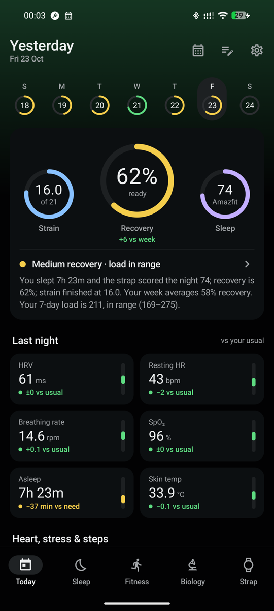
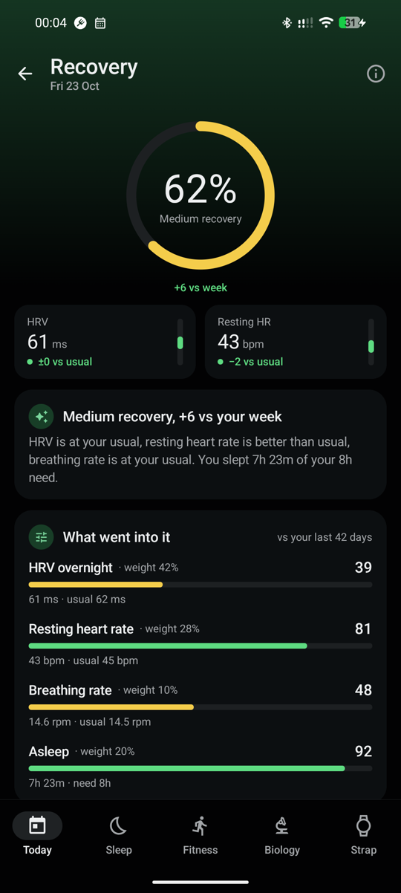
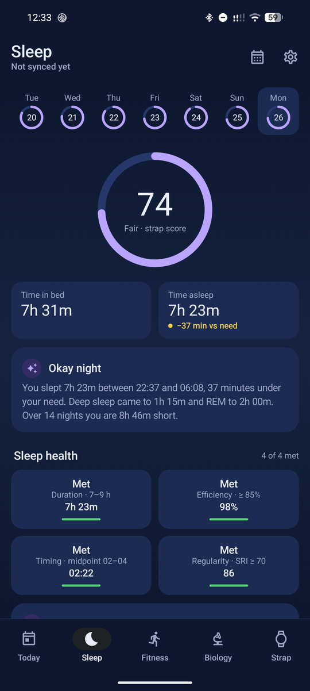
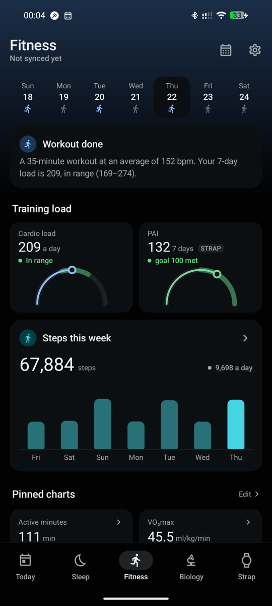
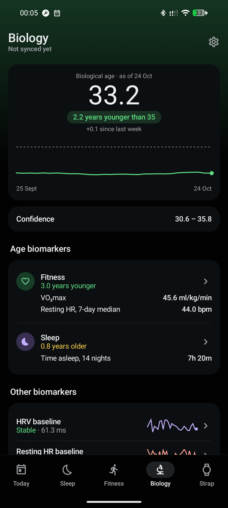

# Ridge

**Your Amazfit Helio Strap's data, off the Zepp cloud and on your phone, with honest, cited
metrics, a light Android app and an optional backup on your own server.**

Ridge syncs the strap directly over Bluetooth. Nothing goes through Zepp's servers when you
use it. The phone works out your days itself, offline: recovery, strain, sleep, heart rate,
stress, steps and more. A small server you run yourself is optional: it keeps a copy, backed
up once a night, so a new phone can start from your whole history.

`strap` is the codename you will see in the code, the server and the package names.

  
  
  
  
  

Screenshots show synthetic demo data (`tools/demo-data`), not a real person's.

## What you get

- **Today**: strain, recovery and the strap's sleep score as rings, the day in words, and
  last night's HRV, resting heart rate, breathing rate, SpO₂, time asleep and skin
  temperature against your own usual. Heart rate, stress and steps cards draw the whole day
  (coloured by heart-rate zone, stress level, steps adding up) and how it split; steps show
  where you usually are by now. A week strip and a calendar of rings step back through past
  days; heart rate, stress and steps open per-minute charts with the peaks kept.
- **Timeline**: the day hour by hour behind Today's moments, with rings you pin and a quick
  log (coffee, tea, a drink, your weight) at any hour.
- **Energy**: a body battery from 0 to 100, minute by minute. Sleep fills it; movement,
  stress and the waking day drain it, and the Recovery screen shows what did which. With the
  strap off it drifts and then shows a gap rather than freezing.
- **Sleep, Fitness, Biology, Journal**: any of the last seven nights with its stages, sleep
  health and vitals through the night; training load against its range, pinned charts, a
  training calendar and each workout's strain, zones and load; biological age from your
  habits (resting heart rate, steps, sleep regularity and length, strength training); and a
  journal for caffeine, alcohol and weight. The strap's own PAI (Fitness) and its nightly breathing disturbances (Sleep) are shown as the strap's
  figures, and its HRV (SDNN) through the day has its own chart.
- **Strap**: battery, the strap's own alarms (read, add, edit, delete, each in a timezone
  you pick, so a 07:00 alarm rings at 07:00 there), and its heart-rate, stress, SpO₂, sleep
  and workout-detection settings (read-only for now).
- **Live steps**: while Today is on screen the step count follows you, once a second while
  you move.
- **Sync that keeps up**: opening the app syncs when the last sync is over 15 minutes old,
  and optional background sync collects from the strap on an interval you choose (Settings →
  Background sync). With a server, a backup runs once a night while the phone charges on Wi-Fi.
- **Days follow you when you travel**: each day starts at midnight wherever you are, and
  its charts and times are shown in that day's own timezone.
- **Metrics that say why when they can't answer.** A number that lacks the data it needs
  is withheld and names the reason ("sync the strap", "log your weight"), never shown as
  a zero or a guess. Every formula, constant, gate and source is written down in
  [`docs/spec/02-science.md`](docs/spec/02-science.md).
- **Your data stays yours**: on your phone, and on your server if you run one. Ridge has no
  account, no cloud and no analytics. (Your Zepp account is needed once, on your computer, to fetch
  the strap's key, and optionally to copy your older history to your server: see
  [What you need](#what-you-need).)

## What it is not

- **Not a medical device** and not medical advice. The illness flag and similar signals
  are prompts to pay attention, not diagnoses.
- **Not affiliated with Amazfit, Zepp Health or Huami.**
- Not a Zepp app replacement for everything. You still need the Zepp app to pair the
  strap and to update its firmware, and your Zepp account once per pairing to fetch the
  strap's key.

## Limitations

- **Android 12 or newer only.** There is no iPhone app.
- **The Amazfit Helio Strap only.** Confirmed to work on the latest firmware,
  3.27.0.1 (October 2026). Other Zepp OS devices speak a similar protocol but are untested.
- **Without a server there is no backup.** Everything works on the phone alone, but losing
  the phone then loses the history. A small always-on machine with Docker is enough for one.
- **One person per server.** There is one device token, no accounts and no sign-up.
- **Background sync is best effort.** Android decides when the scheduled jobs actually run
  (the intervals are the shortest gaps), and may hold them back while the phone is idle.
- **Getting the strap's auth key needs your Zepp account, once per pairing**, signed in
  with email and password (see [What you need](#what-you-need)).
- Strap settings other than alarms can be read, not yet changed.
- No GPS. English only.

## What you need

- **The strap, paired with the official Zepp app** on your phone, with any pending firmware
  update installed.
- **Your Zepp account's email and password.** The strap only talks to someone who knows its
  *auth key*, 16 bytes the Zepp app created when it paired the strap and stored in your
  Zepp cloud account. Ridge cannot pair a strap or make its own key, so a small script
  signs in to your Zepp account once and reads the key from there. The same sign-in can
  optionally bring your older history across (see
  [Your history](#your-history-the-last-30-days-or-everything)). Accounts that sign in
  with Google, Apple or Facebook don't work unless they also have a password. Signing in
  logs the Zepp app out; the key is not affected.
- **A computer with [uv](https://docs.astral.sh/uv/)** to run that script. The Ridge app
  itself never talks to Zepp.
- **An Android 12+ phone.**
- **Optional: an always-on machine with Docker** for the backup server, reachable from the
  phone over HTTPS.

You end up with the strap's **MAC and auth key** (from your Zepp account) and, with a server,
its **token** (made by the server's setup). The app asks for them during setup.

## Getting started

1. **Optional: run the backup server**: [`deploy/README.md`](deploy/README.md). Docker
   Compose, about ten minutes, then put HTTPS in front of it. Keep the token it prints.
2. **Get your strap's MAC and auth key from your Zepp account**:
   `uv run tools/keyfetch/keyfetch.py you@example.com --qr`. Details, and how to keep the
   Zepp app from grabbing the strap afterwards:
   [`tools/keyfetch/README.md`](tools/keyfetch/README.md). Already use Gadgetbridge? Its
   device export holds the same key.
3. **Install the app** from the
   [latest release](https://github.com/TheCommishDeuce/ridge-helio-strap/releases) and open
   it. Setup walks you through pairing the strap (MAC and key), connecting your server or
   continuing without one, restoring from the server when it already holds your history,
   and the first sync. Later changes live under the gear (Settings).

### Your history: the last 30 days, or everything

Moving to Ridge, you choose how much of your past comes with you:

- **Just the strap: nothing more to do.** The first sync reads what the strap still
  holds, about the last 30 days. You can ignore the Zepp cloud and its data export
  completely.
- **Everything the Zepp app ever synced: optional, one more command.** Your Zepp
  account keeps the strap's history from the months you used the Zepp app. With the
  same email and password you already use for the auth key,
  [`tools/zepp-backfill`](tools/zepp-backfill/README.md) copies it to your server, and the
  phone takes it from there (Settings → Diagnostics → Copy the server's history again):
  per-minute heart rate and steps, stress, sleep with its stages, and daily totals.
  It only fills days the strap didn't deliver, so whatever the strap recorded always
  wins. It works before or after your first sync. The cloud doesn't keep HRV, SpO₂, skin
  temperature or breathing rate, so older days have none of those.

You can backfill at any time later. The cloud keeps your history after you stop using the
Zepp app; it just stops growing.

## How it's built

| Part | Where | What |
|---|---|---|
| Strap protocol | `android/strap-protocol/` | Pure Kotlin/JVM: B-163 ECDH handshake, framing, encryption, fetch rounds, decoders, all tested without a phone |
| Science | `android/strap-science/` | Pure Kotlin/JVM: every derived number, held to golden outputs of the former server |
| App | `android/app/` | Jetpack Compose UI, Bluetooth transport, the local store, live steps, backup and restore |
| Server | `server/` | Optional backup: Python, FastAPI and TimescaleDB; stores what the phone sends and gives it back |
| Self-hosting | `deploy/` | Docker Compose kit and guide |
| Key tool | `tools/keyfetch/` | One-shot Zepp account → MAC and auth key |
| History backfill | `tools/zepp-backfill/` | One-off: your pre-Ridge history from the Zepp cloud, filling only gaps |

More: [`docs/ARCHITECTURE.md`](docs/ARCHITECTURE.md) for how the pieces fit,
[`docs/spec/01-strap-protocol.md`](docs/spec/01-strap-protocol.md) for everything the strap
says over Bluetooth, byte by byte, and [`docs/DECISIONS.md`](docs/DECISIONS.md) for why
things are the way they are. To build, test or contribute, see
[`CONTRIBUTING.md`](CONTRIBUTING.md).

## Licence

AGPL-3.0-or-later (D25): see [`LICENSE`](LICENSE), and [`NOTICE`](NOTICE) for credits and
bundled files. The protocol knowledge comes from
[Gadgetbridge](https://codeberg.org/Freeyourgadget/Gadgetbridge), whose work made this
possible.
