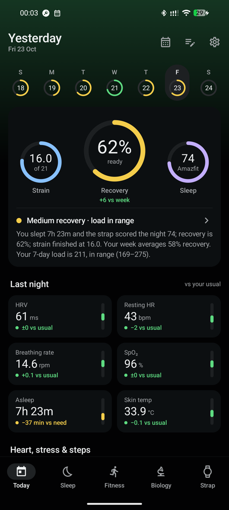
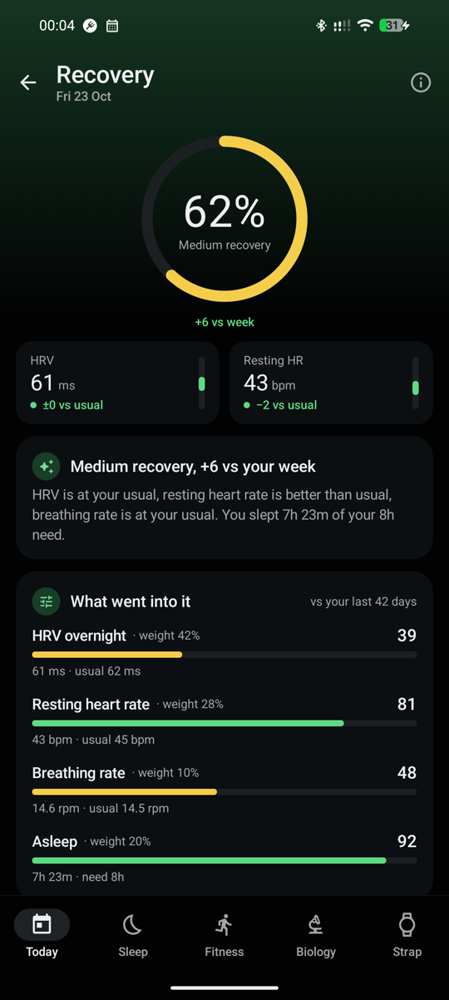
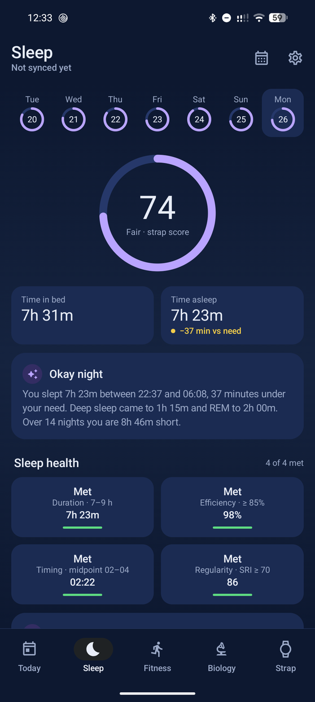
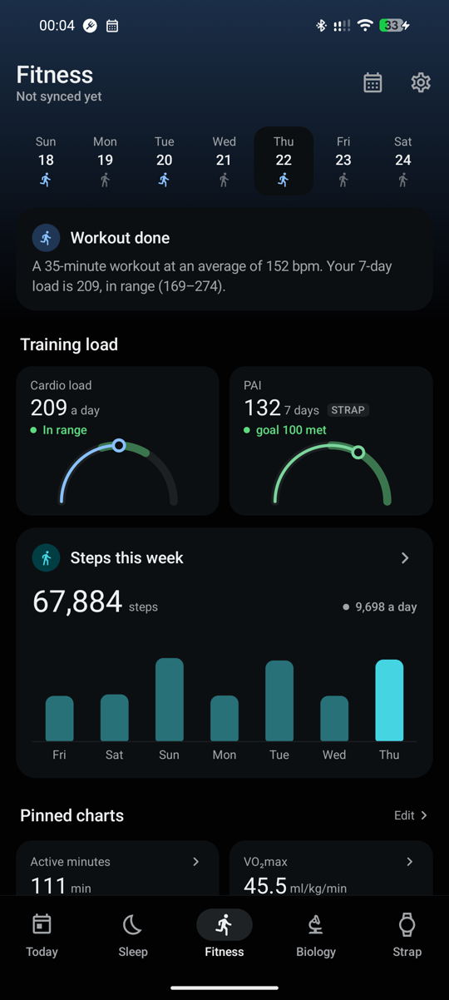
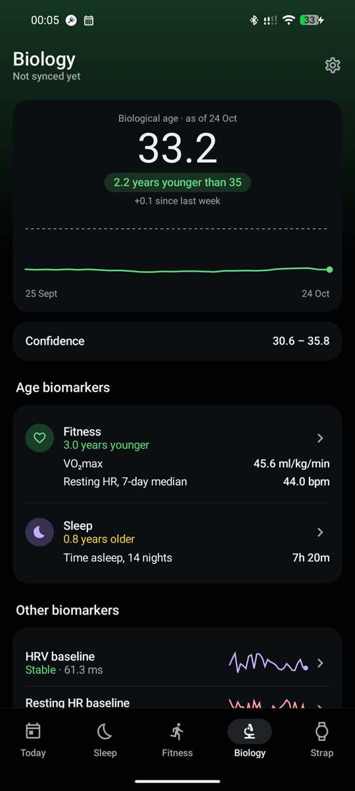
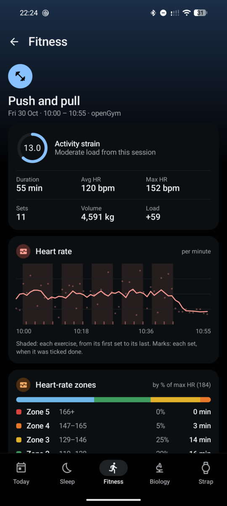
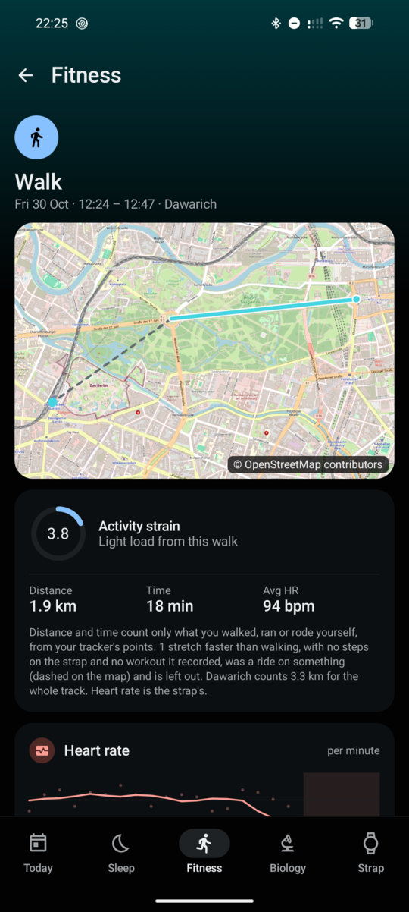
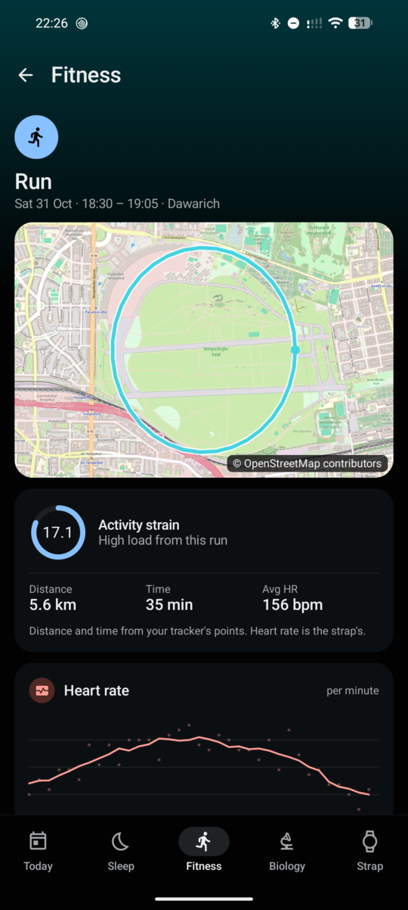

# Ridge

**Your Amazfit Helio Strap's data, off the Zepp cloud and on your phone.**

Ridge is an Android app that syncs the strap directly over Bluetooth and works out your days
itself, offline: recovery, strain, sleep, heart rate, stress, steps and more. Nothing goes
through Zepp's servers, and there is no account, cloud or analytics. A small server you run
yourself is optional: it keeps a nightly backup, so a new phone can start from your whole
history.

  
  
  
  
  

  
  
  

Screenshots show synthetic demo data (`tools/demo-data`), not a real person's.

## What you get

- **Today**: strain, recovery and sleep as rings, last night's vitals against your own
  usual, the day's heart rate, stress and steps, and an hour-by-hour timeline. Steps follow
  you live while the screen is open.
- **Energy**: a body battery from 0 to 100, minute by minute, with what filled and drained it.
- **Sleep**: any recent night with its stages, sleep health and vitals through the night.
- **Fitness**: training load against its range, a training calendar, and each workout's
  strain, zones and load. Add a session the strap missed, edit one it got wrong or hide a
  false detection; a workout the strap detects by itself is announced after the next sync.
- **Biology and Journal**: biological age from your habits, and a log for caffeine, alcohol
  and weight.
- **Strap**: battery, the strap's own alarms, and its heart-rate, sleep, stress, SpO₂ and
  workout-detection settings, each written to the strap and read back.
- **Integrations, all optional** (Settings → Integrations):
  - **Health Connect**: Ridge writes your days there for other apps on the phone to read.
    Write-only.
  - **[openGym](https://github.com/DuarteSantos8/openGym)**: your gym sessions on Fitness,
    with the strap's heart rate through each exercise and set. Read-only.
  - **[Dawarich](https://github.com/Freika/dawarich)**: your walks, runs and rides on a map
    with the heart rate through them. Read-only; Ridge itself never records location.
- **Honest numbers**: a metric that lacks the data it needs is withheld and says why, never
  shown as a zero or a guess. Every formula and source is in
  [`docs/spec/02-science.md`](docs/spec/02-science.md).

Syncing happens when you open the app and, if you turn it on, in the background. Days start
at midnight wherever you are.

## Good to know

- **Not a medical device**, and not medical advice. Not affiliated with Amazfit, Zepp Health
  or Huami.
- **Android and the Amazfit Helio Strap only.** Confirmed on firmware 3.27.0.1 (October
  2026). English only.
- **You still need the Zepp app** to pair the strap and update its firmware, and your Zepp
  account once per pairing to fetch the strap's key.
- **Without a server there is no backup**: losing the phone loses the history. A server
  holds one person's data.
- **Background sync is best effort**: Android decides when it actually runs.
- **Workout detection is the strap's own.** It can miss a session or cut it short; you can
  add or stretch it afterwards.

## Getting started

You need the strap paired with the official Zepp app (firmware up to date), your Zepp
account's **email and password**, and a computer with [uv](https://docs.astral.sh/uv/).

1. **Optional: run the backup server.** Docker Compose on any always-on machine, with HTTPS
   in front: [`deploy/README.md`](deploy/README.md). Keep the token it prints.
2. **Get your strap's MAC and auth key** from your Zepp account:
   `uv run tools/keyfetch/keyfetch.py you@example.com --qr`. The strap only talks to someone
   who knows this key, and Ridge cannot make its own. Accounts that sign in with Google,
   Apple or Facebook don't work unless they also have a password, and signing in logs the
   Zepp app out.
   Details: [`tools/keyfetch/README.md`](tools/keyfetch/README.md).
3. **Install the app** from the
   [latest release](https://github.com/TheCommishDeuce/ridge-helio-strap/releases). Setup
   walks you through pairing, the server (or none), restoring, and the first sync.
4. **Optional: connect integrations** under Settings → Integrations.

**Your older history.** The first sync reads what the strap still holds, about the last 30
days. To bring across everything the Zepp app ever synced, run
[`tools/zepp-backfill`](tools/zepp-backfill/README.md) once, at any time: it copies your
Zepp cloud history to your server, filling only days the strap didn't deliver.

## How it's built

`strap` is the codename you will see in the code, the server and the package names.

| Part | Where | What |
|---|---|---|
| Strap protocol | `android/strap-protocol/` | Pure Kotlin/JVM: B-163 ECDH handshake, framing, encryption, fetch rounds, decoders, all tested without a phone |
| Science | `android/strap-science/` | Pure Kotlin/JVM: every derived number, held to golden outputs of the former server |
| App | `android/app/` | Jetpack Compose UI, Bluetooth transport, the local store, live steps, backup and restore |
| Server | `server/` | Optional backup: Python, FastAPI and TimescaleDB; stores what the phone sends and gives it back |
| Self-hosting | `deploy/` | Docker Compose kit and guide |
| openGym names | `tools/opengym-names.sh` | Rebuilds the app's exercise-name table from openGym's catalogue |
| Key tool | `tools/keyfetch/` | One-shot Zepp account → MAC and auth key |
| History backfill | `tools/zepp-backfill/` | One-off: your pre-Ridge history from the Zepp cloud, filling only gaps |

More: [`docs/ARCHITECTURE.md`](docs/ARCHITECTURE.md) for how the pieces fit,
[`docs/spec/01-strap-protocol.md`](docs/spec/01-strap-protocol.md) for everything the strap
says over Bluetooth, byte by byte, and [`docs/DECISIONS.md`](docs/DECISIONS.md) for why
things are the way they are. To build, test or contribute, see
[`CONTRIBUTING.md`](CONTRIBUTING.md).

## Licence

AGPL-3.0-or-later (D25): see [`LICENSE`](LICENSE), and [`NOTICE`](NOTICE) for credits and
bundled files. The protocol knowledge comes from
[Gadgetbridge](https://codeberg.org/Freeyourgadget/Gadgetbridge), whose work made this
possible. Workout sport names and the summary layout come from
[OpenStrap](https://github.com/sayed0am/openstrap) (Apache-2.0).
